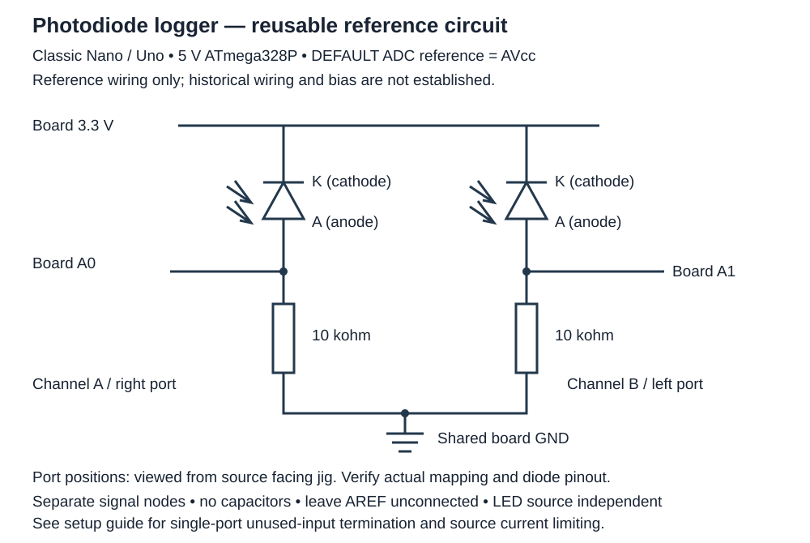

# Arduino photodiode setup

This reusable reference circuit and reference code (unchanged functional source, with a license comment preamble) support the [single-port](../designs/v11/single-port/PRINT_SINGLE_V11.md) and [dual-port](../designs/v11/dual-port/PRINT_SIMPLE_V11.md) V11 jigs. They do not establish measured historical wiring, bias, calibration or optical performance. Arduino code is **AGPL-3.0-only** under the complete [Arduino license](../arduino/LICENSE). CAD, the circuit diagram and setup documentation are **CERN-OHL-S-2.0** under the unchanged root [LICENSE](../LICENSE). AGPL-compliant commercial use is permitted. Separate paid non-copyleft closed-source commercial licensing requires a written agreement through [info@qxcellerate.com](mailto:info@qxcellerate.com); an inquiry alone grants no rights. Connecting an independent application does not automatically make it subject to the AGPL; obligations depend on the license terms and how software is combined, modified and conveyed or made available for remote interaction.

## Parts and circuit

Use a **Classic Arduino Nano or Uno, 5 V ATmega328P**, a USB data cable, one or two photodiodes with identifiable leads, two independent 10 kohm resistors for dual-port use, and insulated wiring/breadboard. Other Nano families and 3.3 V boards are outside this setup. Check the diode manufacturer's pinout: lead length or package markings alone are not a universal polarity guide.



| Connection | Channel A | Channel B |
| --- | --- | --- |
| Photodiode cathode (K) | Board 3.3 V | Board 3.3 V |
| Photodiode anode (A) / signal node | A0 | A1 |
| Independent load resistor | 10 kohm from A0 node to GND | 10 kohm from A1 node to GND |
| Ground | Shared board GND | Shared board GND |
| Intended physical position, viewed from source facing jig | Right | Left |

Each anode, ADC input and resistor top are the same node. Each cathode connects to the board **3.3 V pin, not 5 V**. The resistors share GND only at their bottom ends; A0 and A1 are separate nodes. There are no capacitors and no direct signal-node-to-ground shorts in the two-channel reference circuit. The 3.3 V connection supplies diode bias; it is not the ADC reference. Leave AREF unconnected.

Power off before wiring or changing leads. Confirm K/A polarity against the diode datasheet and trace every connection before USB power. Check that neither ADC node is accidentally shorted to GND or the other channel. Use only inputs within the board's allowed voltage range. Illuminate and block each port separately to confirm the actual A0/right and A1/left mapping; record any different mapping. A response to light alone does not prove correct diode polarity.

For a single-port jig, wire its diode and one 10 kohm load to A0 as above. The unchanged sketch still reports A1: **unused A1 data is not meaningful unless that channel is deliberately wired or grounded**. Prefer a deliberate 10 kohm pull-down from unused A1 to GND; label it unused and ignore its columns. This unused-input termination is separate from the illuminated photodiode circuit. Never ground the active signal node directly.

Use a mechanically fixed, low-power visible source at a fixed distance and angle. An LED source is independent of the Arduino logger and needs its own appropriate current-limiting resistor or driver, selected for its supply and LED ratings. Do not connect a bare LED across a supply. Laser, UV and high-voltage SPAD wiring are outside scope. Secure the jig, source and wiring so shutter operation does not move them; no phone mount is required.

## Upload with Arduino IDE

1. Install Arduino IDE and its **Arduino AVR Boards** package through Boards Manager. Connect the board with a USB data cable.
2. Download this repository and open [photodiode_logger.ino](../arduino/photodiode_logger/photodiode_logger.ino) in its matching `photodiode_logger` folder. The functional source matches the reference exactly; only a license comment preamble has been added.
3. Select **Arduino Uno**, or **Arduino Nano** with processor **ATmega328P**, and select the board's USB port. For a Classic Nano clone whose bootloader requires it, select **ATmega328P (Old Bootloader)** for upload. Confirm the board identity first.
4. Verify, then Upload. Disconnect power before correcting wiring. A missing port may require a suitable USB cable or the USB-to-serial manufacturer's driver.
5. Open Serial Monitor at **115200 baud**. Reset/reopen to capture the header. Use a serial terminal with file logging if a saved CSV is needed; close other serial tools first. Save only serial text, without terminal timestamps or UI decorations.

The CSV header is:

```text
timestamp_ms,raw_a,volts_a,raw_b,volts_b
```

`raw_a` and `raw_b` are fractional averages of 10-bit ADC counts (nominal range 0-1023), not calibrated irradiance. `DEFAULT` uses the board supply/AVcc as the ADC reference on these boards. The sketch assumes exactly **5.0 V** when calculating each voltage as `raw * 5.0 / 1023.0`; actual supply/reference error affects these voltage estimates. The board 3.3 V bias is independent of that conversion assumption. Preserve raw counts and record any independently measured reference externally; this guide supplies no calibration.

For each channel, the code averages 100 retained samples, discarding an initial ADC read before each retained read, with a 1 ms delay per sample. It completes A0 before A1, then prints one row and delays 100 ms. `timestamp_ms` is `millis()` at row printing after both averages, not a timestamp for each conversion; it resets with the board and wraps after about 49.7 days. Acquisition and serial overhead add to the delays, so do not assume a fixed sample rate. It is not simultaneous fast two-channel acquisition and establishes no bandwidth. The built-in LED is held low; the sketch does not control the optical source or record shutter state.

## Detector preflight and repeat procedure

1. Record board, diode identity/polarity, resistor values, actual physical mapping, supply/reference assumptions, source settings, geometry, ambient conditions and shutter labels in your own run notes. Keep the source mechanically fixed throughout.
2. Inspect powered readings for stuck values, unexpected clipping near 0 or 1023, or unstable wiring. Block and illuminate one port at a time, allow readings to settle, and verify the intended channel responds. Investigate polarity, wiring, mapping and ambient leakage before continuing. This is a functional preflight, not calibration or a light-tightness test.
3. **B00 baseline:** with the visible source on at its recorded, fixed setting, set both ports blocked (single-port: CLOSED). Wait for settling, discard rows spanning shutter changes, and capture a documented baseline duration. Record the exact shutter state and start/end rows externally.
4. **B01-B03 repeats:** perform the same documented sequence three times. For dual-port use, include both blocked, left only, both open and right only, explicitly naming the open port in notes. For single-port use, alternate CLOSED and OPEN. Keep the source on at the same setting as B00. Use the same chosen dwell and settling intervals on every repeat and record the row ranges for each state.
5. Compare raw-count baselines and repeat consistency as a wiring/handling check. Note source drift, ambient changes, clipping and movement. Do not infer sensitivity, optical performance, bandwidth or experimental conclusions from this procedure alone.

The labels B00-B03 are generic run labels, not supplied measurements. No results or historical captures accompany this setup.

## Optional compile-only checks

With `arduino-cli` and the Arduino AVR core installed, run from the repository root. Replace each build path with a distinct absolute temporary directory outside the repository:

```sh
arduino-cli compile --fqbn arduino:avr:nano:cpu=atmega328 --build-path <temporary-nano-directory> arduino/photodiode_logger
arduino-cli compile --fqbn arduino:avr:uno --build-path <temporary-uno-directory> arduino/photodiode_logger
```

These checks require no connected hardware and do not upload firmware.
